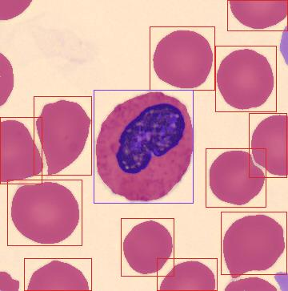
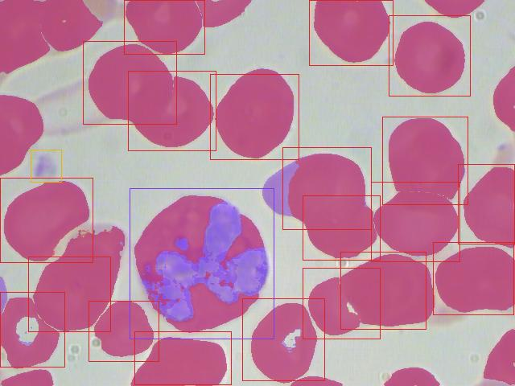

# 02 · SAM 3.1 cell segmentation on TXL-PBC (first pass)

Date: 28/10/2026. Script: `scripts/sam3_validate.py`, run on Modal with
`scripts/modal_sam3.py`. Raw metrics: [`02-sam3-metrics.json`](02-sam3-metrics.json).

## Question

Can SAM 3.1 find and segment the cells on a smear with only a text prompt
("white blood cell", "red blood cell", "platelet"), with no training?
Segmentation is step 1 of the SmearLens pipeline: every cell it misses is a
cell the classifier never sees.

## Setup

| | |
|---|---|
| Model | `facebook/sam3.1` (`sam3.1_multiplex.pt`), image model, confidence threshold 0.5 |
| Hardware | Modal, 1× NVIDIA L40S |
| Data | First 10 images of the TXL-PBC **test** split (7 PBC, 2 BCCD, 1 BCDD) |
| Ground truth | TXL-PBC boxes: 13 WBC, 153 RBC, 4 platelets |
| Concept mode | One text prompt per class, predicted boxes matched to truth at IoU ≥ 0.5 |
| Box mode | Each true WBC box given to SAM as a prompt, we measure how much of the box the mask fills |

## Results

| Class | Truth | Predicted | Matched | Precision | Recall | F1 | Mean count error / image |
|---|---|---|---|---|---|---|---|
| RBC | 153 | 158 | 108 | 0.68 | 0.71 | **0.70** | 9.1 |
| WBC | 13 | 207 | 4 | 0.02 | 0.31 | **0.04** | 19.4 |
| Platelet | 4 | 0 | 0 | 0 | 0 | **0** | 0.4 |

Box mode (WBC): the mask fills on average **29 %** of the true box (minimum 21 %).
**Not reliable, see [03](03-sam3-prompt-sweep.md#notes-and-limits):** the box
step did not start from a fresh image state.

Speed: 3.9 s for the 10 images on the L40S, about 0.4 s per image with the
three prompts. The container image builds in about 30-45 s.

Examples (red = RBC masks and boxes, purple = WBC, yellow = platelet; boxes are
ground truth, tinted areas are SAM masks):

| PBC, one lymphocyte | BCCD, one neutrophil |
|---|---|
|  |  |

## What it tells us

- **Red blood cells work out of the box** (F1 0.70). Most misses are
  overlapping cells at the edges of the image.
- **The "white blood cell" prompt does not work**: about 20 detections per
  image for 1-3 real WBCs. SAM 3.1 answers "a cell" rather than "a white
  cell", so the WBC prompt is no better than a generic cell detector.
- **Platelets are never found** at threshold 0.5. They are small (about 10 px)
  and few (4 in total), so this needs more images before any conclusion.
- **With a box, SAM seemed to segment the nucleus, not the whole cell** (29 %
  of the box; this number turned out to be unreliable, see 03). The nucleus is the most visible object in a WBC. For classification we
  crop on the box, so this does not block the pipeline, but it matters if we
  want cell area or the nucleus/cytoplasm ratio.

For the pitch: a general segmentation model gets the easy cells (RBCs) for
free, but it does not tell white cells from red ones. SmearLens needs its own
detection or classification step for WBCs, which is where the Meta
open-weights classifier comes in (see [01](01-zero-shot-baseline.md)).

## Notes and limits

- 10 images, 13 WBCs: this is a smoke test, not a benchmark. The next run
  should use the full test split.
- Only one prompt per class and one threshold were tried.
- The 0.5 IoU match is strict for small objects like platelets.

## Next

1. Run the full TXL-PBC test split.
2. WBC: try other prompts ("leukocyte", "nucleated cell", "purple nucleus"),
   a higher threshold, or keep SAM's generic "cell" detections and let the
   classifier sort WBC from RBC.
3. Platelets: lower threshold, and a looser IoU for small objects.

## Reproduce

```bash
uv sync --extra modal
modal secret create huggingface HF_TOKEN=...
modal run scripts/modal_sam3.py --limit 10
```
