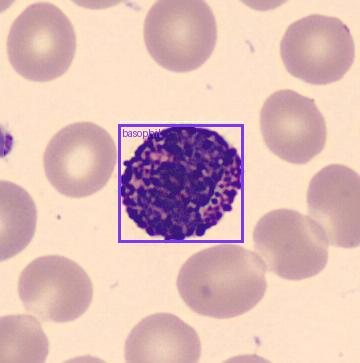
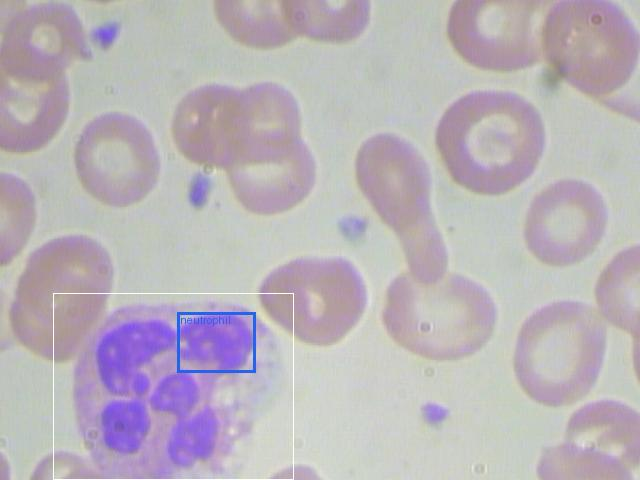

# 04 · End-to-end pipeline: SAM 3 candidates, Muse Spark labels

Date: 28/10/2026. Scripts: `scripts/modal_sam3.py` (detections),
`scripts/pipeline_eval.py` (labels and evaluation), logic in
`smearlens/pipeline.py`. Raw output: [`04-pipeline-summary.json`](04-pipeline-summary.json),
per-image reports: [`04-pipeline-reports.json`](04-pipeline-reports.json).

## Question

Can SmearLens go from a raw smear image to a white blood cell count and a
differential, with no training at all, by chaining the two Meta models?

## Setup

1. **Detect.** SAM 3 (`facebook/sam3`), prompt "cell with a large purple
   nucleus", threshold 0.3 to favour recall ([03](03-sam3-prompt-sweep.md)).
   Nested boxes (one cell, several nucleus lobes) are merged, keeping the
   highest score.
2. **Label.** Each candidate is cropped (square, 1.8× its box, at least 96 px)
   and sent to Muse Spark (`meta-models/muse-spark-open-1026` on Baseten) with
   10 options: the 7 nucleated cell types, `platelet`, `not_wbc` (red cell,
   fragment, debris) and the instruction to end with `LABEL: <class>`.
3. **Report.** Cells labelled as a nucleated type give the count and the
   differential. Immature granulocytes, erythroblasts, basophils and unclear
   answers are flagged for review first.

Data: full TXL-PBC test split, 82 images (50 PBC, 18 BCCD, 14 BCDD), 87 true
white blood cells. WBC matches use the centre-in-box rule. For the 50 PBC
images, the original PBC file name gives the true type of the white cell, which
lets us score the type as well.

## Results

**White blood cell detection**

| | Precision | Recall | F1 | Count error / image |
|---|---|---|---|---|
| SAM 3 alone (455 candidates) | 0.15 | 0.77 | 0.25 | 4.98 |
| **SAM 3 + Muse Spark** | **0.78** | **0.68** | **0.72** | **0.55** |

Muse Spark rejected 339 of the 455 candidates as `not_wbc` and 36 as
`platelet`. The count error per image drops 9×. By source: 0.34 on PBC,
0.78 on BCCD, 1.00 on BCDD.

**White cell type (PBC images, 55 cells with a known type)**

| True type | Correct | Main errors |
|---|---|---|
| monocyte | 9/13 | 2 erythroblast |
| eosinophil | 9/11 | 2 neutrophil |
| neutrophil | 8/10 | 1 ig, 1 basophil |
| basophil | 5/12 | **5 called platelet**, 2 unparsed |
| lymphocyte | 1/9 | 3 erythroblast, 2 monocyte, 2 never detected by SAM |

Overall 32/55 = **58 %** end to end. Of the cells that the pipeline kept,
32/46 = **70 %** have the right type.

Cost: 604,313 Baseten tokens for 455 calls (about 1,330 per cell). SAM 3: one
Modal L40S run of about 20 s for the 82 images.

Examples (white boxes = ground truth, coloured boxes = cells kept by
SmearLens, with their label):

| PBC: basophil, correct | BCCD: neutrophil, correct but boxed on one lobe |
|---|---|
|  |  |

## What it tells us

- **The two models complement each other.** SAM 3 finds 77 % of the white
  cells but drowns them in false positives. Muse Spark removes most of them:
  precision goes from 0.15 to 0.78 and the count is off by about half a cell per
  image. Neither model was trained for this.
- **The weak point moved to the cell type.** Basophils, packed with dark
  granules, are called platelets on a tight crop. Lymphocytes (small round
  nucleus) are mixed up with erythroblasts. Same pattern as the zero-shot
  baseline ([01](01-zero-shot-baseline.md)): the rare and look-alike cells are
  where a specialised classifier must help.
- The review list works as designed: 15 images out of 82 get a flag
  (basophil, erythroblast, immature granulocyte or unclear answer), and the
  biologist would see those first.

For the pitch: from a raw smear image to a count within about half a cell per
image, with two off-the-shelf Meta models and no training. The next step,
training a classifier on the Muse Spark vision features, targets exactly the
cells that the general model gets wrong.

## Notes and limits

- 82 images and 55 typed cells: wide error bars (about ±13 points on the 58 %).
- PBC images are centred on one white cell, which is easier than a real smear.
  BCCD and BCDD images show the gap (count error 0.78 and 1.00).
- SAM sometimes boxes one nucleus lobe instead of the whole cell (right image).
  The crop at 1.8× still shows the cell, but the box drawn for the biologist
  is too small.
- Recall drops from 0.77 to 0.68 because Muse Spark also rejects some real
  white cells (most of them basophils called platelets).

## Next

1. Train a linear probe on Muse Spark vision features with PBC (Modal), and use
   it instead of the zero-shot label for the cell type.
2. Try a larger crop for small dark cells (basophils, lymphocytes).
3. Grow the SAM box from the nucleus to the whole cell before display.

## Reproduce

```bash
modal run scripts/modal_sam3.py --limit 200 --threshold 0.3 --tag pipeline-detect \
  --wbc-prompt "cell with a large purple nucleus" --platelet-prompt "small purple dot"
export BASETEN_API_KEY=...
uv run python scripts/pipeline_eval.py --images 200
```

Labels are cached in `results/pipeline/labels.jsonl`, so a second run only
recomputes the metrics.
